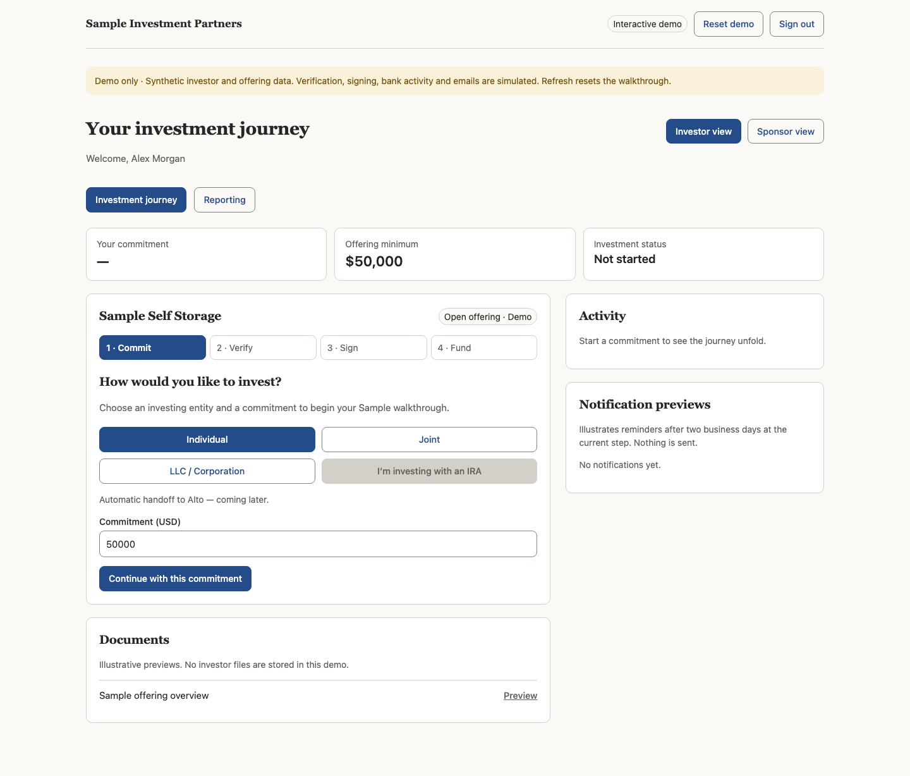
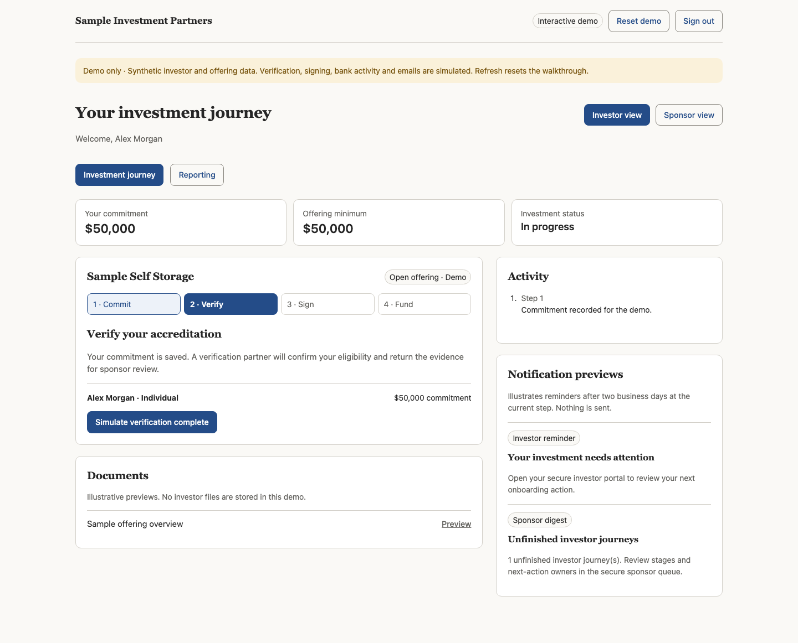
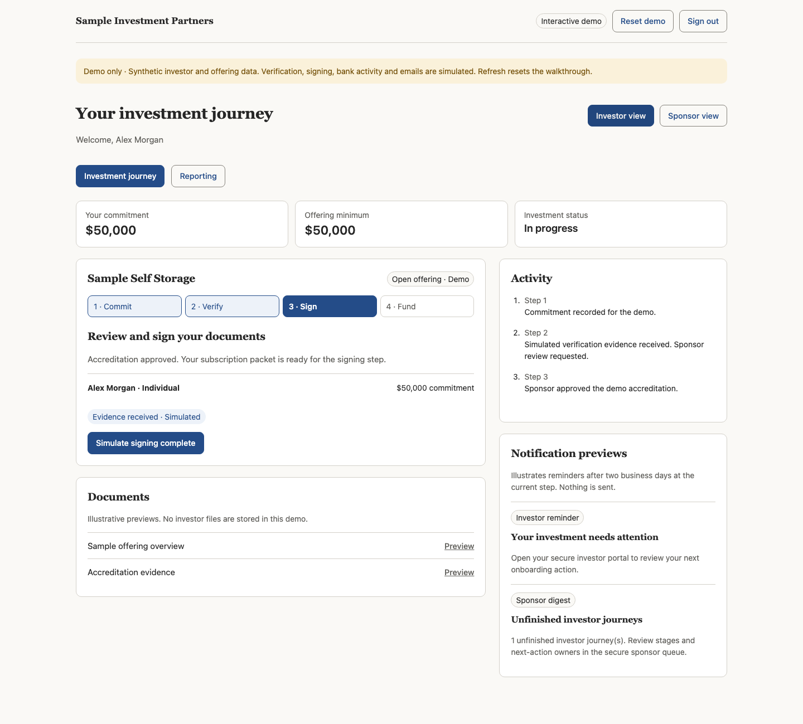
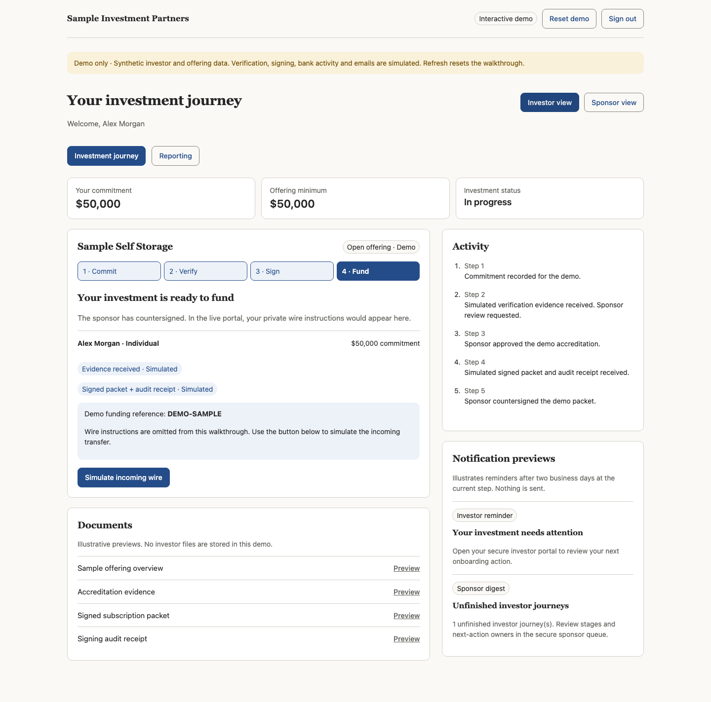
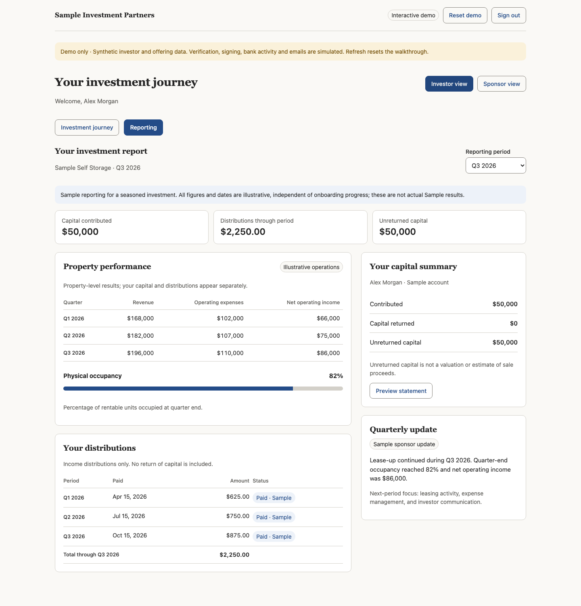
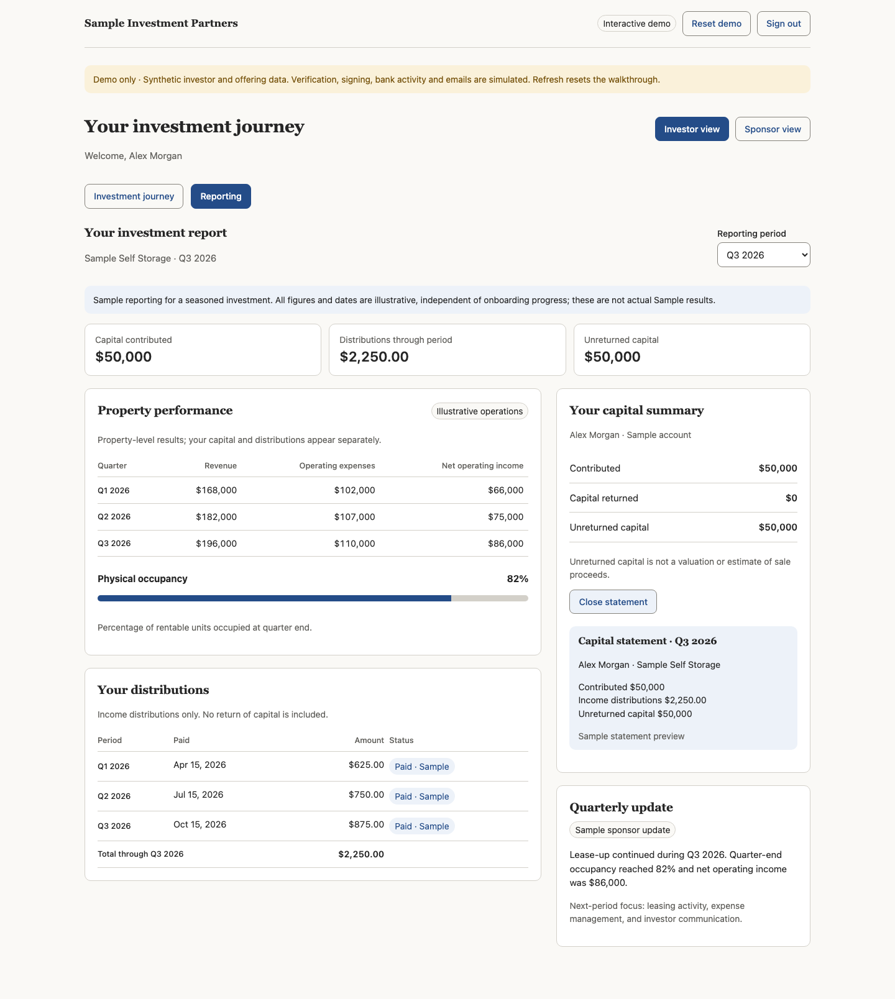
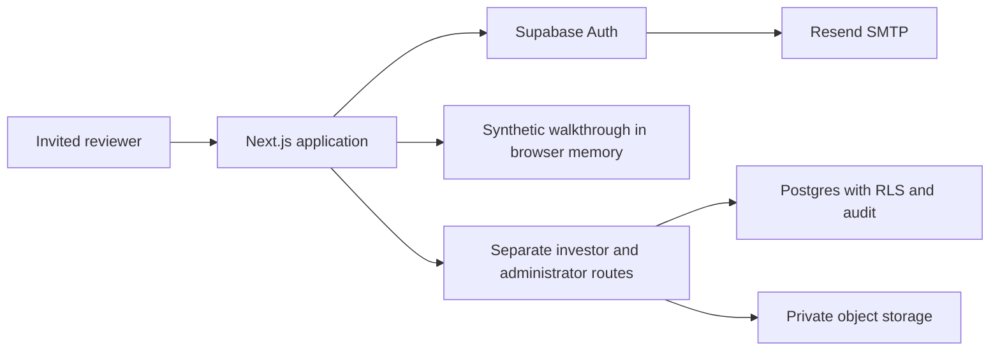

# Investor Portal Demo

An invite-only investor onboarding demo with real email authentication and synthetic investment data. This evaluation package includes the application source, SQL migrations, configuration scripts, tests, and a journey guide. The full MVP will be delivered once the demo is fully tested.

## MVP Design goals

- Give investors one clear next action from commitment through final distribution.
- Support individual, joint, corporate, and IRA investment journeys.
- Keep the interface readable: warm neutral investor screens, a distinct sponsor workspace, and plain status language.
- Enforce real data permissions in the database and private storage, alongside application checks.
- Automate configuration through APIs.
- Keep sensitive tax and wire instruction information out of the app by leveraging existing blue chip providers like Sharefile and Stripe.

## What the reviewer can do

An invited reviewer signs in through a one-time email link and lands on `/demo`. The reviewer can switch between Investor and Sponsor perspectives to complete an illustrative journey. 

1. Choose an investing entity type and sample commitment.
2. Simulate accreditation evidence arriving.
3. Switch to Sponsor view to approve the sample evidence.
4. Return to Investor view and simulate signing the subscription packet.
5. Switch to Sponsor view and countersign.
6. Return to Investor view and simulate an incoming transfer.
7. Switch to Sponsor view and mark the sample investment funded.
8. Explore reporting, distributions, and the capital statement preview.

Reset or refresh to start again. Walkthrough progress lives only in browser memory. Account authentication persists separately until sign-out or session expiry.

### Journey screens

The [illustrated investor journey](docs/INVESTOR-JOURNEY.md) includes all 10 screens: login, commitment, accreditation, sponsor review, signing, countersign, funding, incoming match, reporting, and the capital statement.


| Choose an entity and commitment | Accreditation |
|---|---|
|  |  |

| Sign the subscription packet | Funding |
|---|---|
|  |  |

| Reporting | Capital statement |
|---|---|
|  |  |


## Technology Stack

| Layer | Technology | responsibility |
|---|---|
| UI and server | Next.js App Router, React, TypeScript | server components and server actions |
| Presentation | Plain CSS | responsive layouts, accessible labels and status text |
| Identity | Supabase Auth | email magic links, SSR cookie sessions |
| Database | Supabase Postgres SQL | migrations, row-level security, guards, and audit records |
| Files | Supabase | private object storage and short-lived signed download URLs |
| Email | Resend | SMTP for Supabase | authentication emails |
| Hosting | Render Node web service, custom domain, and HTTPS |
| Tests | Node | test runner, TypeScript test harnesses, and PGlite database checks |

The supplied lockfile pins the shared source snapshot. The package currently declares Next.js 16, React 19, Supabase JS 2, and TypeScript 5; use the lockfile rather than independently upgrading dependencies.



Normal authenticated database requests use the publishable key plus the user's session. The server secret key is reserved for authorized Auth administration, such as sponsor invitations. It bypasses RLS and must never be bundled into browser code. Simulated provider results do not authorize real investments.

## Configure and run a separate evaluation environment

### 1. Local prerequisites

Use Node.js 24 or newer and npm. From this package directory:

```bash
npm ci
cp .env.example .env.local
```

Populate `.env.local` locally. All placeholders in `.env.example` are blank. Never send keys in chat, put them in command arguments, or commit the populated file.

| Variable | Purpose | Confidential? |
|---|---|---|
| `NEXT_PUBLIC_SUPABASE_URL` | Your testing project's URL | Public configuration |
| `NEXT_PUBLIC_SUPABASE_PUBLISHABLE_KEY` | Publishable key | Designed for public clients |
| `SUPABASE_SECRET_KEY` | Server-only Auth admin key | Yes |
| `NEXT_PUBLIC_SITE_URL` | `http://localhost:3000` for local testing | Public configuration |
| `NEXT_PUBLIC_FIRM_NAME` | Display branding, for example Sample Investment Partners | Public configuration |
| `NEXT_PUBLIC_IR_EMAIL` | A test contact inbox you control | Publicly displayed |
| `SUPABASE_SMTP_SENDER_EMAIL` | Sender on your verified Resend domain | Public configuration |

The app uses publishable and secret keys. It does not read the legacy `ANON_KEY` or `SERVICE_ROLE_KEY` variables.

### 2. Supabase and initial account

Create a dedicated testing Supabase project. On a fresh project, run `supabase/demo-bootstrap.sql` once: it contains migrations 0001–0007 plus a clearly marked synthetic offering. Alternatively, apply the numbered migrations in filename order. Do not run both paths or rerun the bootstrap on an existing database.

The bootstrap does not create Auth accounts or promote an administrator. Invite your test reviewer through Supabase Auth. Viewing `/demo` requires a valid Auth session but no GP role or investor database profile. For separate administrator testing, edit `supabase/seed.sql` to the intended test sponsor email before running it; it changes that account's role.

### 3. Configure authentication through the API

Create a Supabase management token scoped to the testing project. Grant **Project → Project Settings → Read-write** and **Application services → Auth Config → Read-write** (also Read if separately selectable).

In your existing Resend account, verify a sending domain and create a dedicated sending API key for it. A sender address on a verified domain need not have its own mailbox to send; choose a clear no-reply sender or arrange a reply-capable inbox. Disable click tracking for authentication links.

On macOS, save management credentials at the prompts:

```bash
security add-generic-password -U -a "$USER" -s "investor-portal-demo/supabase-management-token" -w
security add-generic-password -U -a "$USER" -s "investor-portal-demo/resend-api-key" -w
```

For other environments, use `SUPABASE_ACCESS_TOKEN` and `RESEND_API_KEY` in the process environment or gitignored `.env.local`. Environment values override Keychain entries.

```bash
npm run supabase:config                 # Offline preview
npm run supabase:config -- --check       # Read hosted settings; exit 1 if different
npm run supabase:config -- --apply       # Apply and verify non-secret settings
npm run dev
```

Open `http://localhost:3000/login` and request a link for the invited test address. The script sets invite-only access, SMTP, Site URL, callback allowlist, and the magic-link/invitation templates. It preserves unrelated settings and existing redirects. The SMTP password is supplied on apply but cannot be verified through masked readback; test actual delivery.

### 4. Optional Render deployment

Publish your reviewed source to a repository you control. In `scripts/deploy-render.mjs`, replace the example repository constant with that repository URL. Connect the corresponding Git deployment credential to your Render account and authorize the repository.

Save a Render API key at the prompt:

```bash
security add-generic-password -U -a "$USER" -s "investor-portal-demo/render-api-key" -w
```

Set `RENDER_SITE_URL` in `.env.local` to your intended public HTTPS origin, for example `https://ims.example.com`. The deployment script's example default must be replaced for a real deployment. If multiple workspaces are available, use `--owners` and set `RENDER_OWNER_ID`.

```bash
npm run render:deploy                   # Offline preview
npm run render:deploy -- --apply        # Free Node service from pushed main
npm run render:deploy -- --status
```

The script sends only selected app environment variables to Render. Management tokens and the Resend API key are not uploaded. Add the CNAME printed by the command at your DNS provider, then run:

```bash
npm run render:deploy -- --verify-domain
npm run render:deploy -- --status
```

Wait for a live deployment, verified domain, and working HTTPS. Then apply Supabase's public email destination:

```bash
NEXT_PUBLIC_SITE_URL=https://ims.example.com npm run supabase:config -- --apply
```

Request a fresh hosted magic link and verify login, anonymous-access rejection, the complete synthetic journey, and sign-out. Free Render services can sleep after inactivity. `render.yaml` is also supplied for a Blueprint-based alternative; the API command creates a standalone service, not a Blueprint-managed service.

### Troubleshooting

| Symptom | Check |
|---|---|
| No authentication email | Exact invited Auth user, rate limits, Supabase SMTP settings, Resend sending key/domain and delivery log; a `profiles` row alone is insufficient |
| Link goes to localhost or an internal host | Supabase Site URL, hosted `NEXT_PUBLIC_SITE_URL`, and deployment of the public-origin callback fix; request a fresh link |
| Render says repository is unfetchable | Render Account Security → Git Deployment Credentials, plus GitHub App access to the private repo |
| Custom domain unverified | Correct CNAME, propagation, and `--verify-domain`; HTTPS follows verification |
| Configuration command cannot find a key | Correct Keychain service/account; environment or `.env.local` overrides may contain an older value |
| `/portal` reports missing/unavailable profile | Apply missing numbered migrations to the testing project; `/demo` itself does not query profiles |

## Roadmap: work remaining before a production MVP

These are acceptance requirements and dependencies, not claims of completed integrations. Provider names describe current implementation directions, not completed contracts or approved coverage. No completion dates are committed.

| Phase | Remaining work | Completion evidence |
|---|---|---|
| 1. Core safeguards | Validate evidence completeness, signed-document prerequisites, investor-cap concurrency, transactional/idempotent distribution writes, and spreadsheet-safe CSV exports. Retest database and storage access with real Supabase roles. | Negative-path tests, security review, and an approved policy checklist |
| 2. Verification and signing | Connect an accreditation provider (current direction: AccreditedNow) and e-sign provider (current direction: DocuSeal). Confirm entity coverage, archive final PDFs and audit evidence, and synchronize statuses automatically. | Real test-provider journeys, authenticated callbacks, mismatched/stale/duplicate-event recovery, explicit sponsor review and countersign |
| 3. Durable operations | Persist provider events, retries, recovery state and notification outbox; connect integration exceptions to the sponsor queue. | Replay/recovery tests and visible ownership of unresolved failures |
| 4. Read-only bank matching | Connect Mercury incoming-transaction monitoring. Approve exact acceptance rules for posted funds, entity/reference matching, partial/excess/third-party payments, ambiguity and returns. | Reconciled test receipts and exceptions; no outgoing-payment capability |
| 5. Operational notifications | Deliver investor next-action reminders and a daily sponsor unfinished-journey digest. Approve timing, business calendars and send windows; implement bounce and suppression handling. | Outbox/delivery evidence, duplicate prevention, and reminders stopping when ownership/status changes |
| 6. Identity and IRA | Add invite-only Google login resolving to the same investor identity. Confirm IRA/custodian eligibility and early Alto handoff, approval, prefill and status synchronization. | Tested individual/joint/company/IRA routes; documented identity linking and supported custodian path |
| 7. Documents and resilience | Establish sensitive-document rules, retention, private-object backup, database backup, audit-object backup, and a restore drill. | Successful restoration and access checks; credentials and sensitive fields absent from operational logs |
| 8. Pilot readiness | Browser end-to-end tests, responsive/accessibility review, account/security controls, monitoring, dependency review, production configuration, and policy/legal approval. | A controlled synthetic pilot followed by an explicitly approved production readiness decision |

Earlier hardening migrations address several funding, minimum-commitment, and per-entity document isolation gaps. Passing those tests does not resolve every remaining safeguard above. Signed PDFs, wire-instruction text and audit rows can contain sensitive identifiers; the broader application must be treated as a sensitive-document system even though this walkthrough uses fixtures.

Waterfall/distribution automation, advanced investor analytics, and a product MCP connector are later backlog items. Outgoing payments and marketing/newsletter delivery are outside this MVP. The sample reporting screens do not implement those capabilities.

## Validate and navigate the source

```bash
npm test
npm run test:db
npm run build
```

| Path | Purpose |
|---|---|
| `app/demo/`, `lib/demo-*.ts` | Protected synthetic walkthrough and reports |
| `app/auth/`, `app/login/` | Login, callback and sign-out |
| `app/portal/`, `app/admin/` | Separate database-backed application foundation |
| `lib/integrations/`, `lib/operations/` | Simulated provider normalization and notification planning |
| `supabase/migrations/` | Ordered schema, RLS, guards, grants and audit changes |
| `scripts/configure-supabase.mjs` | Supabase Auth configuration API command |
| `scripts/deploy-render.mjs` | Render API deployment and DNS-verification command |
| `tests/` | Unit, regression and database checks |


### How this was built

The application and documentation were developed with assistance from OpenAI Codex. Automated tests and operator review support the current demo; independent review and the MVP acceptance work above remain required before production use.

### Reference documentation

- [Supabase API keys](https://supabase.com/docs/guides/getting-started/api-keys)
- [Supabase Auth configuration API](https://supabase.com/docs/reference/api/v1-update-auth-service-config)
- [Resend SMTP with Supabase](https://resend.com/docs/send-with-supabase-smtp)
- [Render API](https://render.com/docs/api)
- [Render Git provider connection](https://render.com/docs/git-provider)
- [Render custom domains](https://render.com/docs/custom-domains)
