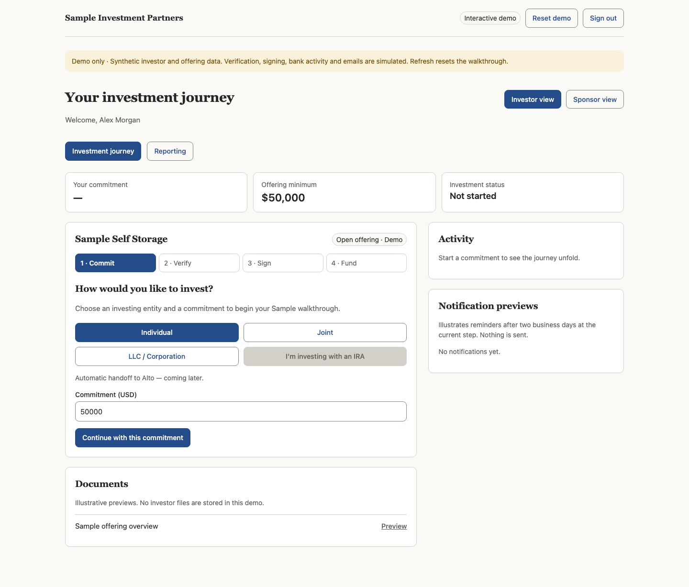
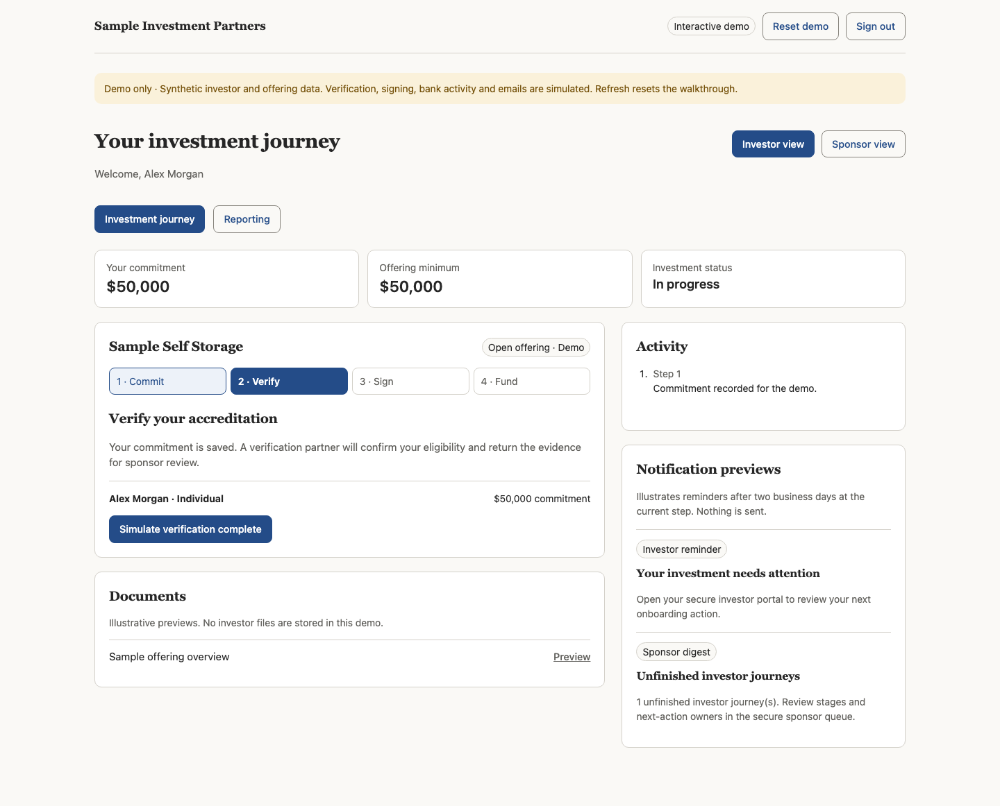
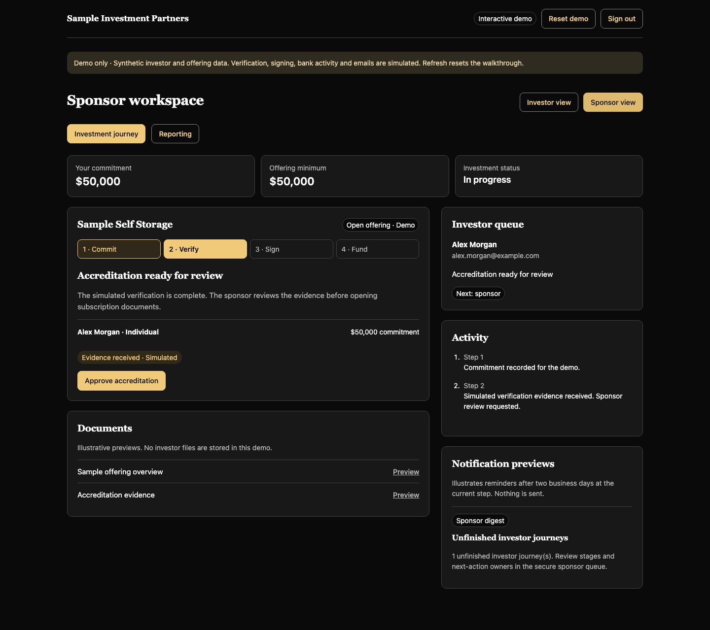
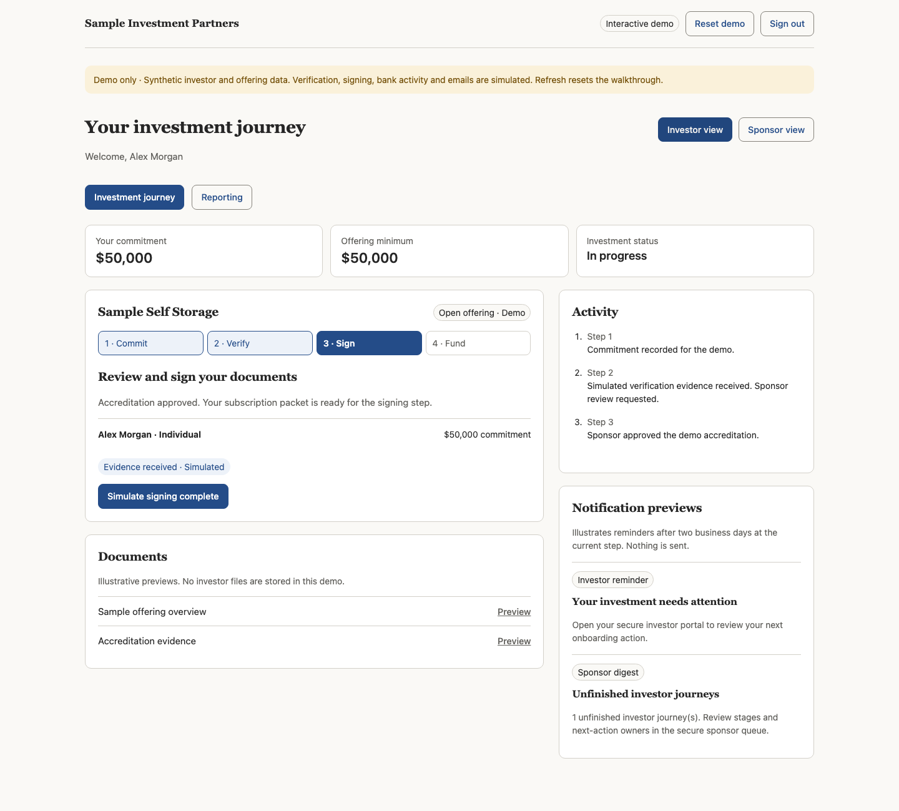
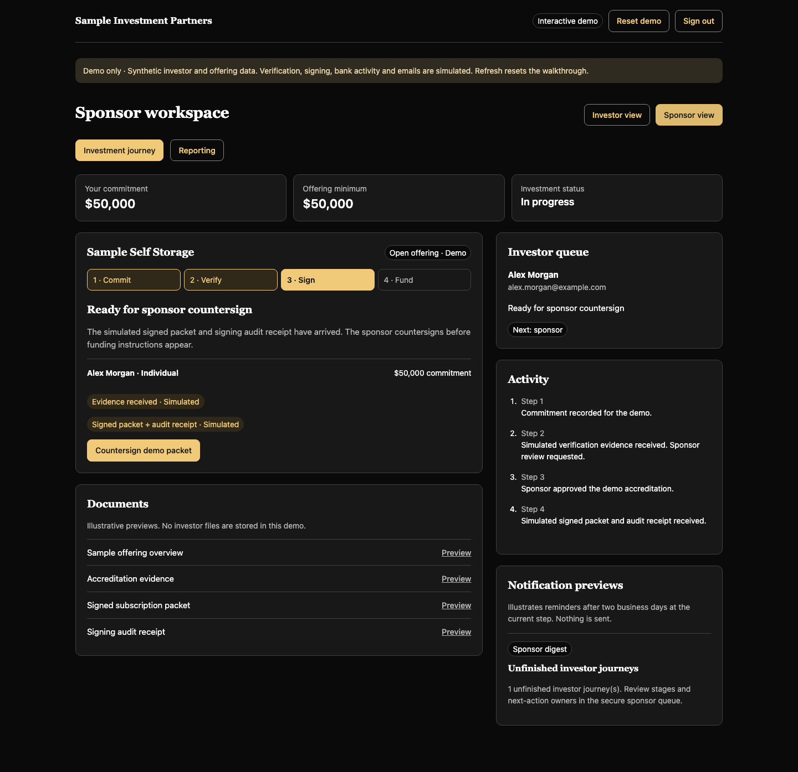
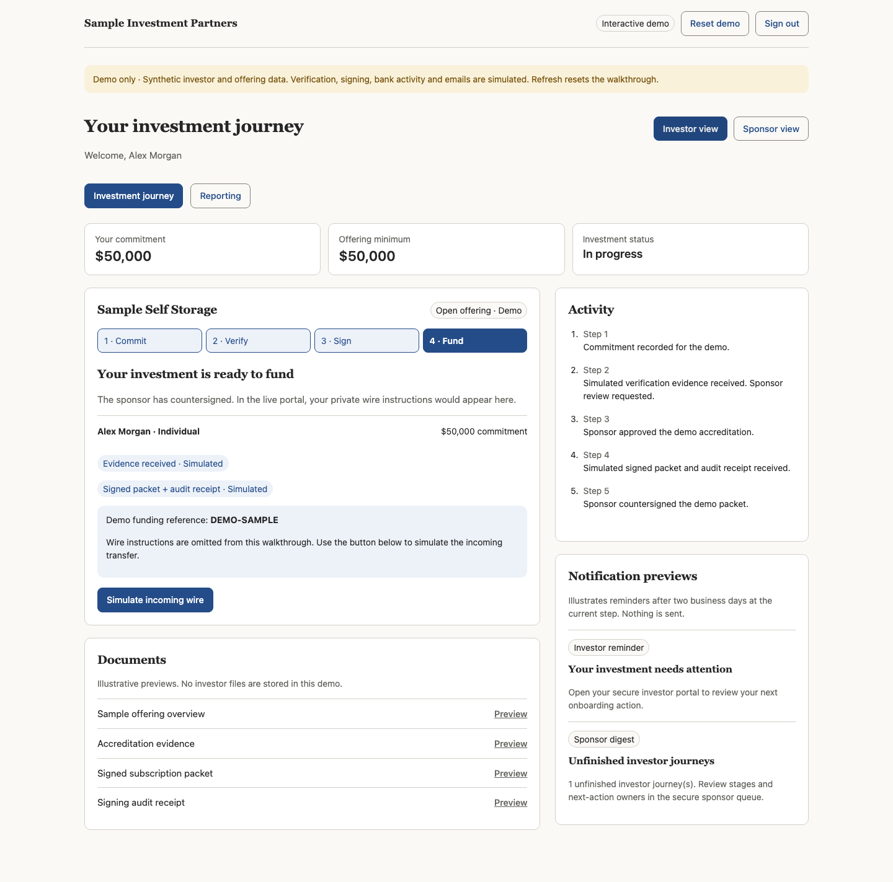
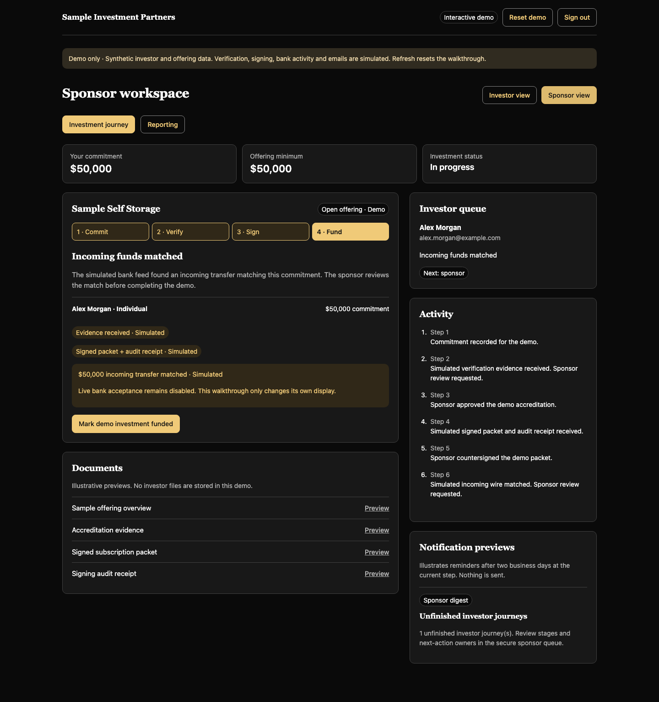
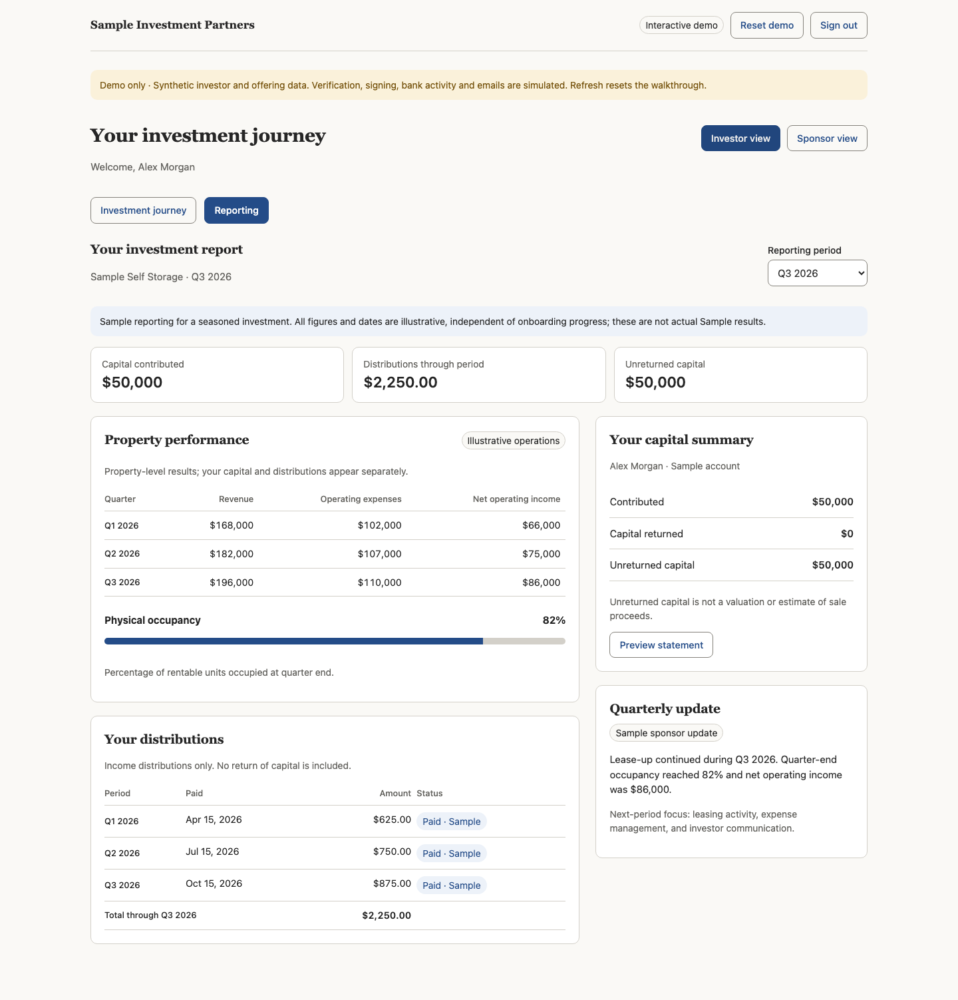
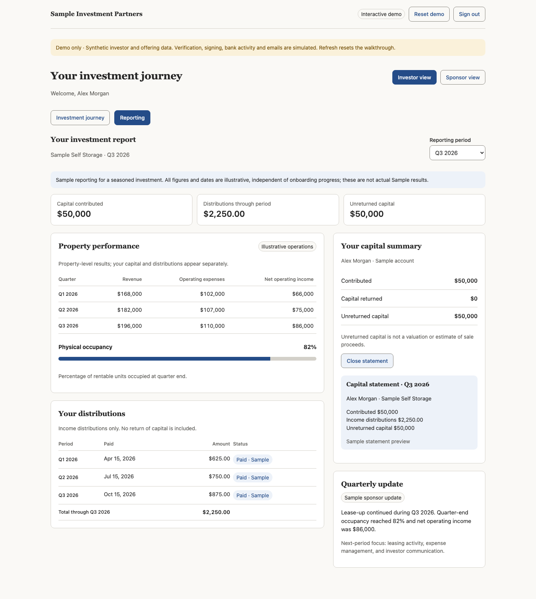

# Investor journey

This guide follows Alex Morgan, a fictional investor in Sample Self Storage. All investment amounts, dates, activity, evidence, documents, and performance figures are illustrative. The full application uses real invite-only authentication. These 10 captures render the actual sanitized UI components in an isolated local browser, with authentication actions stubbed only for capture. No live account or database was accessed. Browser chrome is excluded; full-page captures retain the activity and notification context.

## 1. Sign in

An invited reviewer requests a one-time email link. Supabase verifies the link and establishes a session before opening the walkthrough. The email address must exist in Supabase Auth; a database profile alone does not authorize login.

## 2. Choose an entity and commitment

Investor view offers individual, joint, and company routes. The sample commitment starts at $50,000. The IRA button is disabled because automatic custodian routing is unfinished. Continuing creates only a browser-memory demo commitment.

## 3. Accreditation evidence

The investor simulates receipt of verification evidence. This requests sponsor review; it does not itself approve an investment. Real evidence retrieval, provider authentication, and private archiving remain MVP work.

## 4. Sponsor review

Switch to Sponsor view to inspect the fictional queue, activity, and notification previews. Approving the sample accreditation unlocks signing in the walkthrough. This perspective switch has no relationship to real database roles or permissions.

## 5. Sign the subscription packet

Return to Investor view and simulate signing. The walkthrough records sample signed-packet and audit-receipt markers. Document previews are explanatory text, not real signed PDFs.

## 6. Sponsor countersign

Switch to Sponsor view and countersign the sample packet. Verification, investor signing, and countersign remain separate steps. The sponsor action unlocks the funding stage without authorizing any real transaction.

## 7. Funding and incoming match

Return to Investor view and simulate the incoming transfer. Real wire instructions are omitted. A matched receipt still belongs to sponsor review: switch to Sponsor view to mark the sample investment funded. No account is connected and no funds move.

The match is a proposal, separate from the sponsor's final funding decision:

## 8. Reporting and statement

Completion opens Reporting. Review property revenue, expenses, net operating income and occupancy separately from investor distributions and capital. Choose a quarter and open the capital statement preview. These figures represent a fictional seasoned investment, not results generated by completing onboarding. Sample income distributions do not reduce unreturned capital, and unreturned capital is not a valuation.

## Reset, sign out, and boundaries

- Reset or refresh clears the synthetic journey; it does not change authentication.
- Sign out ends the real session in the full application.
- The walkthrough does not fetch investor records or persist an investment.
- Operational notification previews send nothing. The login email is a separate, real authentication message.
- Real `/portal` and `/admin` functions are separate code paths. The package must use a dedicated synthetic testing project for evaluation.
